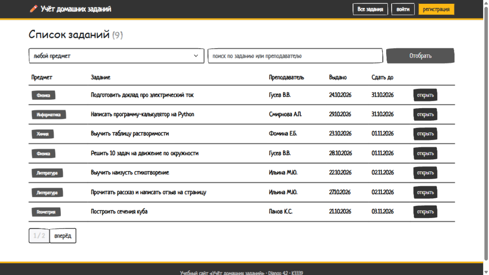
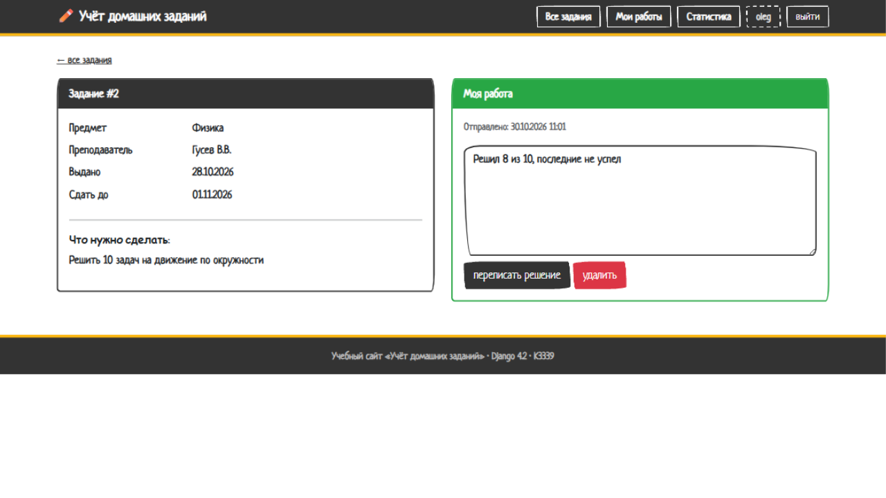
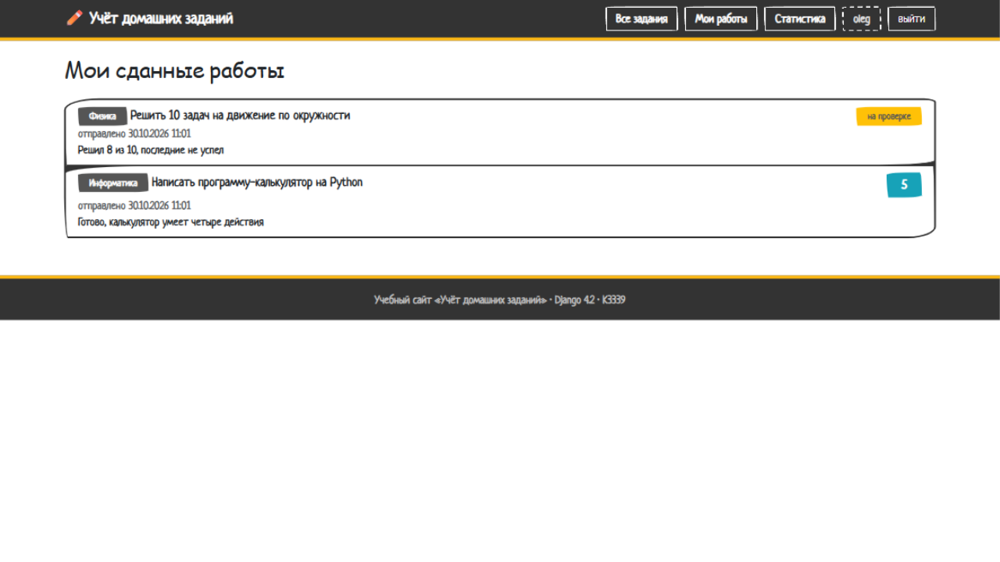
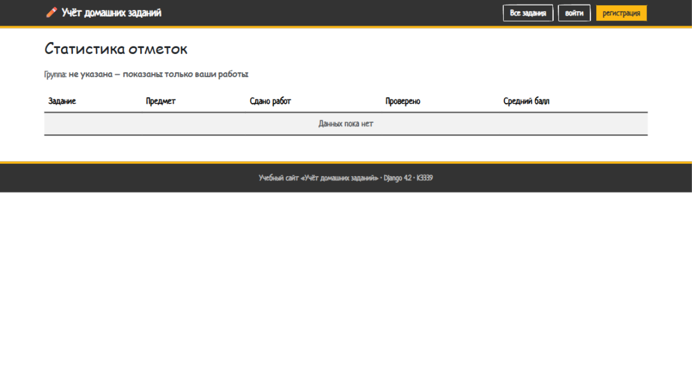
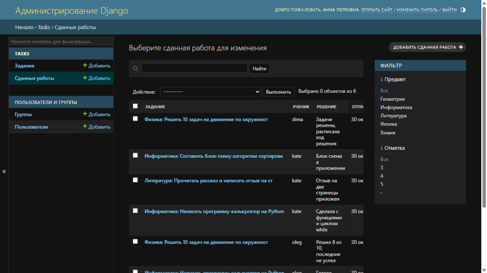

# ЛР2. Простое приложение на Django

Титор Матвей, группа K3339, вариант 2 — «Доска домашних заданий».

Веб-приложение на Django: учитель публикует домашние задания, ученики
отправляют решения текстом, учитель выставляет отметки через панель
администратора, есть статистика отметок по учебным группам.
Дизайн — Bootstrap 5 (тема Bootswatch Sketchy).

Проект — пакет `board`, приложение — `tasks`.

## Модель данных

Три модели. Связи: у задания много сданных работ (ForeignKey),
у пользователя одна карточка с учебной группой (OneToOne).

### Task — домашнее задание

| Поле         | Тип            | Описание                        |
|--------------|----------------|---------------------------------|
| discipline   | CharField(120) | Предмет                         |
| teacher_name | CharField(120) | Преподаватель                   |
| issued_on    | DateField      | Дата выдачи                     |
| due_on       | DateField      | Срок выполнения                 |
| body         | TextField      | Текст задания                   |
| penalty      | TextField      | Штрафы за опоздание (необязательно) |

### Work — сданная работа

| Поле      | Тип                       | Описание                             |
|-----------|---------------------------|--------------------------------------|
| task      | ForeignKey → Task         | Задание (CASCADE, related_name=works) |
| student   | ForeignKey → User         | Ученик (CASCADE, related_name=works)  |
| body      | TextField                 | Текст решения                        |
| sent_at   | DateTimeField             | Время отправки (auto_now_add)        |
| score     | PositiveSmallIntegerField | Отметка (выставляет учитель в админке) |
| scored_at | DateTimeField             | Дата выставления отметки             |

Ограничение: уникальная пара (задание, ученик) — одно задание нельзя сдать дважды.

### StudentProfile — карточка ученика

| Поле        | Тип                  | Описание          |
|-------------|----------------------|-------------------|
| user        | OneToOneField → User | Пользователь      |
| study_group | CharField(60)        | Учебная группа    |

## Страницы и ключевые views

Все страницы — функциональные views. Роль учителя — `is_staff`/`is_superuser`.

### Список заданий (`/`, view `task_list`)

Фильтр по предмету, поиск по тексту задания и преподавателю, пагинация
по 7 заданий, отметка «сдано» для заданий, которые текущий ученик уже сдал.

```python
objects = Task.objects.all()

if discipline:
    objects = objects.filter(discipline=discipline)
if search:
    objects = objects.filter(Q(body__icontains=search) | Q(teacher_name__icontains=search))

page = Paginator(objects, 7).get_page(request.GET.get('page'))
```



### Страница задания (`/task/<id>/`, view `task_detail`)

Слева карточка задания, справа — работа ученика: отправка решения,
изменение и удаление, пока не выставлена отметка. Если решение отправлено
позже срока — показывается предупреждение.

```python
if button == 'send' and my_work is None:
    form = WorkForm(request.POST)
    if form.is_valid():
        work = form.save(commit=False)
        work.task = task
        work.student = request.user
        work.save()
```



Учитель на этой странице видит все работы класса и ссылку на админку.

### Мои работы (`/mine/`, view `my_works`)

Только для вошедших (`@login_required`): отправленные работы текущего
ученика с отметками, пагинация.



### Статистика (`/stats/`, view `class_stats`)

Агрегация средствами ORM: количество работ, проверенных и средний балл
по каждому заданию. Ученик видит свою группу (без группы — только свои
работы), учитель выбирает любую группу через `?group=` и видит таблицу
по всем группам.

```python
stat_rows = list(
    base.values('task_id')
    .annotate(total=Count('id'), checked=Count('score'), average=Avg('score'))
    .order_by('task_id')
)
```



### Регистрация (`/signup/`, view `signup`)

Форма на основе `UserCreationForm` с полем «учебная группа». При
сохранении создаётся карточка ученика `StudentProfile`.

## Отметки через Django-admin

Отметки выставляет учитель в админке: список «Сданные работы» с фильтрами
по предмету и отметке. Дата выставления подставляется автоматически.

```python
def save_model(self, request, obj, form, change):
    if obj.score is not None and obj.scored_at is None:
        obj.scored_at = timezone.now()
    super().save_model(request, obj, form, change)
```



## Шаблоны

`tasks/base.html` — общий каркас: тёмная полоса сверху с меню (состав
зависит от авторизации и роли), уведомления django messages, подвал.
Дочерние шаблоны наследуют его через `` и заполняют блок
`content`. Ссылки строятся тегом `` по именам маршрутов.

## Запуск

```bash
python -m venv .venv
.venv\Scripts\activate
pip install -r requirements.txt
python manage.py migrate
python manage.py fill_data
python manage.py runserver
```

Демо-учётки: учитель `anna / anna12345`, ученики `oleg`, `kate`, `dima`
(пароль `pass12345`).

Тесты: `python manage.py test tasks` — 16 тестов.
