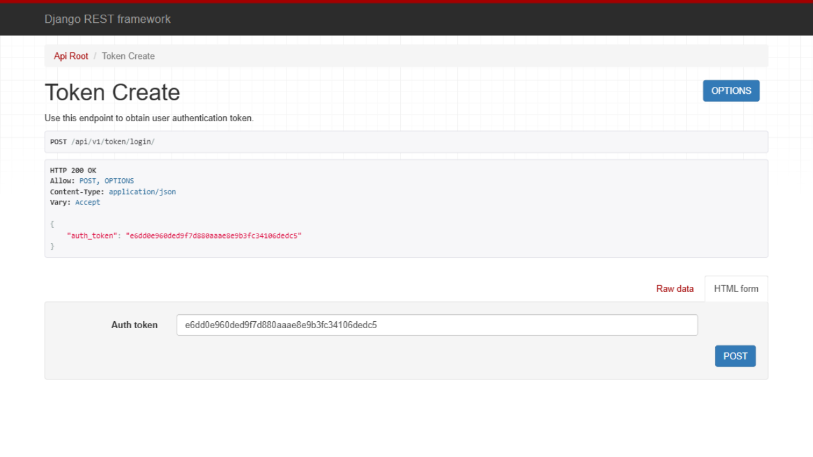
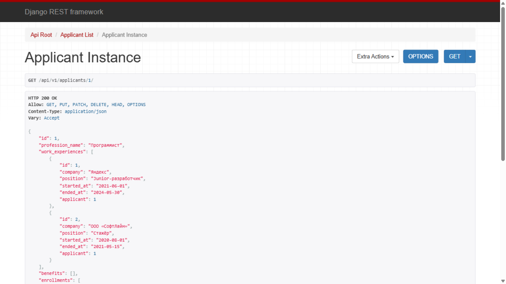
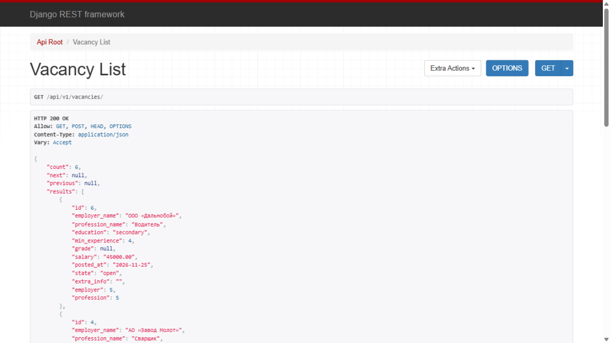

# ЛР3. Серверная часть на Django REST Framework. Документирование API

Титор Матвей, группа K3339, вариант 11 — «Биржа труда» (модель БД
согласована с преподавателем). Стек: Python 3.10+, Django 4.2,
Django REST Framework, Djoser (токен-авторизация), PostgreSQL.

Код лабы — `students/K3339/laboratory_works/Titor_Matvey/laboratory_work_3`
(проект `core`, приложение `exchange`), практик 3.1/3.2 —
`students/K3339/practical_works/Titor_Matvey/simple_drf_project`.

## Модель данных

Девять таблиц по утверждённой схеме.

| Таблица | Поля (основные) | Связи |
|---|---|---|
| Profession | name (уник.) | 1—N Applicant, Vacancy, Course |
| Applicant | ФИО, дата рождения, паспорт (уник.), телефон, email, education (4 варианта), grade, experience_years, last_salary, registered_at | FK Profession |
| WorkExperience | компания, должность, даты | FK Applicant |
| Employer | название, адрес, контактное лицо, телефон, email | 1—N Vacancy |
| Vacancy | education, min_experience, grade, salary, posted_at, state (open/offered/closed), extra_info | FK Employer, Profession |
| Benefit | amount, started_at, ended_at | FK Applicant |
| Course | название, даты | FK Profession |
| Enrollment | enrolled_at, result_grade, уникальная пара (соискатель, курс) | FK Applicant, Course |
| VacancyMatch | suggested_at, accepted, уникальная пара (соискатель, вакансия) | FK Applicant, Vacancy |

## Авторизация (Djoser)

Токены (`rest_framework.authtoken`) + Djoser. Чтение — всем, запись — только
аутентифицированным (`IsAuthenticatedOrReadOnly`).

| Метод | URL | Действие |
|---|---|---|
| POST | `/api/v1/users/` | регистрация |
| POST | `/api/v1/token/login/` | получить токен |
| POST | `/api/v1/token/logout/` | выйти (токен удаляется) |
| GET | `/api/v1/users/me/` | текущий пользователь |



## CRUD-эндпоинты (DefaultRouter)

| Сущность | URL |
|---|---|
| Профессии | `/api/v1/professions/` |
| Соискатели | `/api/v1/applicants/` |
| Места работы | `/api/v1/work-experiences/` |
| Работодатели | `/api/v1/employers/` |
| Вакансии | `/api/v1/vacancies/` |
| Пособия | `/api/v1/benefits/` |
| Курсы | `/api/v1/courses/` |
| Записи на курсы | `/api/v1/enrollments/` |
| Подборы вакансий | `/api/v1/vacancy-matches/` |

У каждой — стандартный набор GET (список) / POST / GET / PUT / PATCH / DELETE,
пагинация по 10 записей.

## Запросы из задания (кастомные действия ViewSet)

| Требование задания | Эндпоинт | Реализация |
|---|---|---|
| Все варианты вакансий для соискателя | `GET /applicants/{id}/matching_vacancies/` | фильтр по профессии, образованию (ранг ≥ требуемого), разряду (≥ требуемого), стажу (≥ требуемого), состояние open |
| Выплачиваемые сейчас пособия | `GET /benefits/active/` | `started_at ≤ сегодня` И (`ended_at` NULL или `≥ сегодня`) |
| Незакрытые вакансии + дней с подачи | `GET /vacancies/unclosed_days/` | `exclude(state='closed')`, дни = разница дат, сортировка по убыванию |
| Профессии, не представленные в вакансиях | `GET /professions/unrepresented/` | `filter(vacancies__isnull=True)` — антиджойн |
| Вакансии: высшее образование, ЗП 5000–60000 | `GET /vacancies/premium/` | фильтр `education='higher'`, `salary__range` |
| Отчёт: открытые вакансии по работодателям | `GET /employers/` | поле `open_vacancies_count` в сериализаторе |

## Ключевые блоки кода

Подбор вакансий (сложность — сравнение «уровней» образования):

```python
EDUCATION_ORDER = {'primary': 1, 'secondary': 2, 'vocational': 3, 'higher': 4}

allowed_education = [
    code for code, rank in EDUCATION_ORDER.items()
    if rank >= EDUCATION_ORDER[applicant.education]
]
vacancies = Vacancy.objects.filter(
    state='open',
    profession_id=applicant.profession_id,
    education__in=allowed_education,
)
if applicant.grade is not None:
    vacancies = vacancies.filter(Q(grade__isnull=True) | Q(grade__lte=applicant.grade))
vacancies = vacancies.exclude(min_experience__gt=applicant.experience_years)
```

Детально соискатель — вложенные сериализаторы (места работы, пособия,
записи на курсы, подборы):



Список вакансий (пагинация, имена работодателя и профессии через
`source`-поля сериализатора):



Валидация подбора — профессия соискателя должна совпадать с профессией
вакансии (`serializers.py`, `VacancyMatchSerializer.validate`).

## Запуск и проверка

```bash
python -m venv .venv && .venv\Scripts\activate
pip install -r requirements.txt
# PostgreSQL: база labour_exchange, postgres/postgres (см. README)
python manage.py migrate
python manage.py fill_data
python manage.py runserver
python manage.py test exchange   # 17 тестов
```

Пример сессии (curl):

```text
$ curl -X POST -H "Content-Type: application/json" -d '{"username":"teacher","password":"strong-pass-777"}' http://127.0.0.1:8000/api/v1/token/login/
{"auth_token": "e6dd0e96..."}

$ curl -H "Authorization: Token e6dd0e96..." -X POST -H "Content-Type: application/json" -d '{"name":"Тестолог"}' http://127.0.0.1:8000/api/v1/professions/
→ 201 (без токена — 401)

$ curl http://127.0.0.1:8000/api/v1/applicants/1/matching_vacancies/
[{"Программист | ООО «Код и кофе» | 58000.00"}]
```

Тесты: 17 штук (регистрация/логин/me, права на запись, CRUD, все 6
запросов из задания, уникальные ограничения) — все зелёные.
